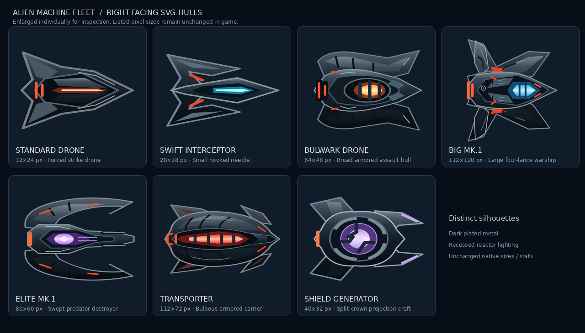

## Remaining five hulls and separate guns converted to flat fleet style — 2026-11-06

The pending visual pass is complete in source: **Gunner Drone** (48×30 hull and 12×44 gun), **Heavy Gunner Drone** (62×42 hull and 18×50 gun), **Shield Emitter** (40×32), **Shield Frigate** (72×48) and **Elite Assault Ship** (80×60) now follow the charcoal `#111920`/`#1e252c`/`#30363c`, near-black `#05080c`, muted scarlet `#ad2729` and tiny orange-red `#ff6039` palette. All seven SVG source files use **solid fills and strokes only**—no baked gradients, filters or per-frame rendering code. The two shield support ships deliberately keep **violet reactor/projection accents**. Elite is now red, not violet. Starter and Heavy Gunner retain independent rotating barrel sprites and the original Godot muzzle origins.

All original hull outlines, native canvas sizes, right-facing directions, gun socket alignments and independent weapon/payload scenes are preserved. No changes to ships' gameplay statistics, shields, weapons, classifications, IDs, waves or F2 registration. Obsidian Dreadnought remains a distinct advanced capital-ship art variant; its already-black/red palette is not modified. Source/file sanity checks only; owner visual approval in Godot pending. Older statements describing which subset has the finished flat style are historical.

---

## Flat dark fleet substyle — 2026-10-26 baseline; 2026-11-05 companion passes

The original `Enemy001`, `Enemy002`, `Enemy004` and `Cruiser/cruiser_mk1` redesigns are now joined by `ReinforcedDrone`, `Racer`, `HeavyBulwark`, `Enemy005`, `Transporter` and `HeavyTransporter`. These ten have a *deliberately consistent look*: solid charcoal armour (#111920, #1e252c, #30363c), thick almost-black recess/outline (#05080c), muted scarlet (#ad2729) and small orange-red drive/core details (#ff6039). **No baked gradients, reflection highlights, SVG filters, glow or particles** in these assets; each keeps its unique silhouette and its original native canvas/facing. This flat style supersedes earlier gradient-oriented descriptions **for these ten ships only**; other fleet assets are unchanged pending a separate art pass.

The new companion silhouettes remain distinct: Reinforced Drone is a plated fork-fighter (40×30), Racer an open-wing needle (34×18), and Heavy Bulwark an enlarged segmented siege hull (88×64). All three preserve their original SVG paths and native canvases; no scene, ID, combat, clearance or wave changes accompany the artwork. Owner in-game visual review remains pending.

The 2026-11-05 heavy/cargo pass adds the four-lance **Heavy Warship (112×120)**, the bulbous ribbed **Drone Transporter (112×72)** and the larger industrial **Heavy Transporter (160×112)**. The latter alone has a scoped native canvas increase from 144×100; all three retain their existing viewBoxes and +X facing. Owner visual acceptance is pending.

Enemy004 remains a **broad twin-nacelle tusked Bulwark**, 64×48, while Cruiser remains an **elongated capital ship with flanking nacelles and distinct propulsion bays**, 168×96. Collision/navigation footprint, scene path and authored definitions are independent of their new artwork.

---

# Alien machine fleet — hull art guide

The user's spacecraft references inform an original vector fleet: armored mechanical hulls, exposed reactors, swept fins and darker metal with a readable outer bevel. Silhouette must distinguish roles even before reactor color is visible. Do not reduce every enemy to the same diamond/arrow body. The Transporter is deliberately a swollen carrier rather than another thin fighter. The Shield Emitter has physical circular machinery; actual shields remain the separate shared gameplay visual.

| Existing type | Native canvas | Current shape |
| --- | --- | --- |
| Standard Drone / Enemy001 | 32×24 | Forked strike drone |
| Swift Interceptor / Enemy002 | 28×18 | Tiny hooked needle |
| Bulwark Drone / Enemy004 | 64×48 | Broad tusked assault cruiser |
| Big mk.1 / Enemy005 | 112×120 | Large four-lance warship |
| Elite mk.1 / Enemy006 | 80×60 | Curved talon-wing predator |
| Transporter | 112×72 | Bulbous armored carrier |
| Shield Emitter / Enemy003 | 40×32 | Rounded split-fork projector |

Retain each existing viewBox and +X nose convention; keep native canvas sizes except for explicitly requested resizing (Heavy Transporter now 160×112). All types still use their original independent artwork paths. Every plate, slit, rail and engine mark is cosmetic; this pass adds no attacks, emissive lights, particles or shader. SVG gradients/geometry bake into the normal imported Sprite2D texture. Avoid blur filters, external images/fonts and runtime-drawn decorative geometry. Small ships must read from a few strong features at native scale; save finer panel detail for larger hulls.

The seven SVGs were loaded by Godot 4.7.2's native Image.load_svg_from_string rasterizer and checked for exact expected dimensions plus nonempty geometry. Enlarged and native-relative rendered sheets were visually inspected. The PNG above is a documentation contact sheet rendered from the new SVGs, with each ship enlarged individually; it is not a source texture or an accurate relative-size comparison. No scene/.tres/CS/config changes are included. Desktop in-game appearance can be fine-tuned without touching balance.

## Fleet expansion — 2026-10-18

Six additional SVGs accompany ReinforcedDrone (40×30), Racer (34×18), ShieldFrigate (72×48), HeavyBulwark (88×64), Cruiser (168×96) and HeavyTransporter (144×100). Reinforced split plates, a slender open Racer, reactor-equipped Frigate, tusked heavy armor, long capital nacelles and a ribbed carrier distinguish the new hulls. Same +X orientation and imported geometry conventions. The original seven-ship image above is retained and does not include this expansion.
