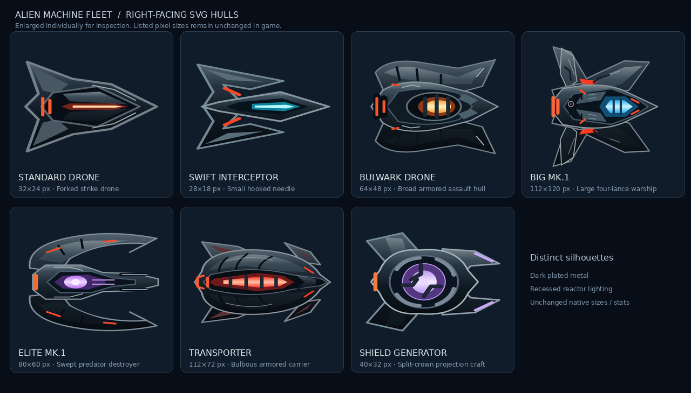

# Alien machine fleet — hull art guide

The user's spacecraft references inform an original vector fleet: armored mechanical hulls, exposed reactors, swept fins and darker metal with a readable outer bevel. Silhouette must distinguish roles even before reactor color is visible. Do not reduce every enemy to the same diamond/arrow body. The Transporter is deliberately a swollen carrier rather than another thin fighter. The Shield Generator has physical circular machinery; actual shields remain the separate shared gameplay visual.

| Existing type | Native canvas | Current shape |
| --- | --- | --- |
| Standard Drone / Enemy001 | 32×24 | Forked strike drone |
| Swift Interceptor / Enemy002 | 28×18 | Tiny hooked needle |
| Bulwark Drone / Enemy004 | 64×48 | Broad tusked assault cruiser |
| Big mk.1 / Enemy005 | 112×120 | Large four-lance warship |
| Elite mk.1 / Enemy006 | 80×60 | Curved talon-wing predator |
| Transporter | 112×72 | Bulbous armored carrier |
| Shield Generator | 40×32 | Rounded split-fork projector |

Keep each existing width, height, viewBox and +X nose convention. All types still use their original independent artwork paths. Every plate, slit, rail and engine mark is cosmetic; this pass adds no attacks, emissive lights, particles or shader. SVG gradients/geometry bake into the normal imported Sprite2D texture. Avoid blur filters, external images/fonts and runtime-drawn decorative geometry. Small ships must read from a few strong features at native scale; save finer panel detail for larger hulls.

The seven SVGs were loaded by Godot 4.7.2's native Image.load_svg_from_string rasterizer and checked for exact expected dimensions plus nonempty geometry. Enlarged and native-relative rendered sheets were visually inspected. The PNG above is a documentation contact sheet rendered from the new SVGs, with each ship enlarged individually; it is not a source texture or an accurate relative-size comparison. No scene/.tres/CS/config changes are included. Desktop in-game appearance can be fine-tuned without touching balance.

## Fleet expansion — 2026-10-18

Six additional SVGs accompany ReinforcedDrone (40×30), Racer (34×18), ShieldFrigate (72×48), HeavyBulwark (88×64), Cruiser (168×96) and HeavyTransporter (144×100). Reinforced split plates, a slender open Racer, reactor-equipped Frigate, tusked heavy armor, long capital nacelles and a ribbed carrier distinguish the new hulls. Same +X orientation and imported geometry conventions. The original seven-ship image above is retained and does not include this expansion.
